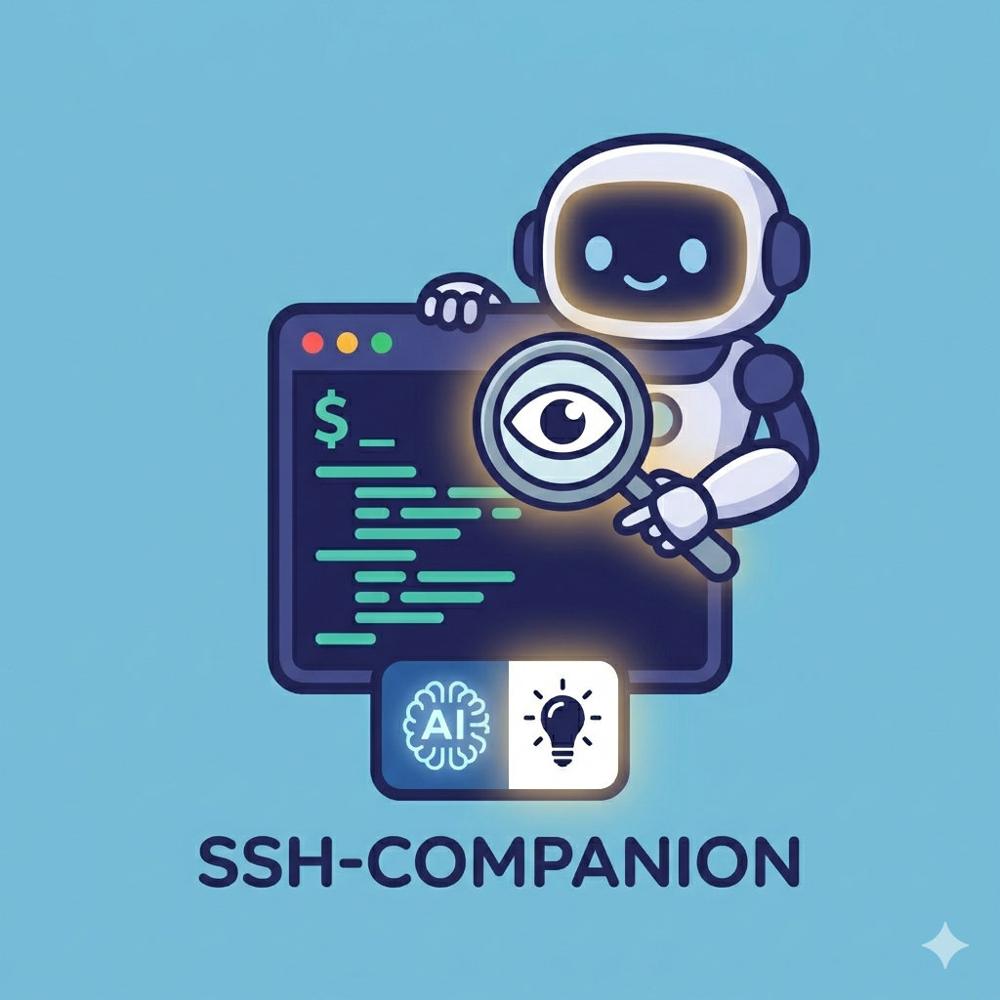
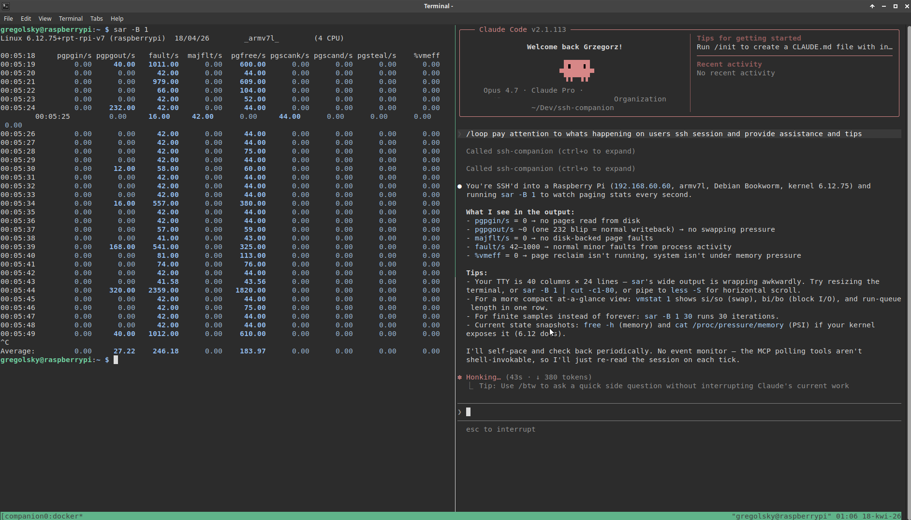
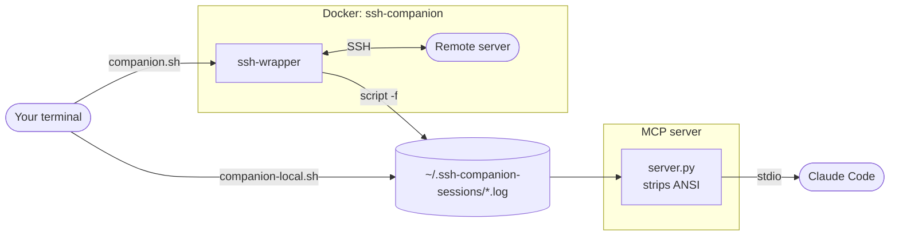

# ssh-companion

<p align="center">

</p>

> "I am always here if you need me, though I confess I find the most enjoyment in simply observing."
> — *Daneel Olivaw, The Caves of Steel* (Isaac Asimov)

An MCP server that lets Claude observe your SSH and local shell sessions in real time and advise on support problems — performance issues, log analysis, error detection — without touching anything.

## 🍭 How it looks

<p align="center">

</p>

## 🔍 How it works

A Docker container acts as the SSH chokepoint. Every session you open through the container is silently captured via `script` to a log file. Local sessions are captured the same way, directly on the host. The MCP server reads those logs and exposes them to Claude. Works with nested tmux on the remote, any shell, any terminal — capture happens at the raw byte stream level.



## 📋 Prerequisites

- Docker
- tmux (Linux) or Windows Terminal / `wt` (Windows)
- [Claude Code CLI](https://claude.ai/code)

## 🚀 Setup

### 1. Start the container

Pull the pre-built image from GitHub Container Registry and run it:

```bash
mkdir -p -m 700 ~/.ssh-companion-sessions
docker run -d --name ssh-companion \
  --cap-drop=ALL --security-opt=no-new-privileges \
  -v ~/.ssh:/home/companion/.ssh:ro \
  -v ssh-companion-known-hosts:/home/companion/.ssh-companion \
  -v ~/.ssh-companion-sessions:/sessions \
  --restart unless-stopped \
  ghcr.io/gregolsky/ssh-companion:latest
```

**About the key mount:** `ssh` runs *inside* the container as a non-root `companion` user, so it can only read keys that are visible inside the container. The `-v ~/.ssh:/home/companion/.ssh:ro` line above mounts your host SSH directory **read-only** at the companion user's home — your usual keys (`id_ed25519`, `id_rsa`, etc.), `config` and `known_hosts` are picked up as normal, but nothing in the container can modify them. Newly accepted host keys go to the `ssh-companion-known-hosts` volume instead (the image's `/etc/ssh/ssh_config.d/companion.conf` lists it first in `UserKnownHostsFile`). If your `~/.ssh/config` sets its own `UserKnownHostsFile` or a `ControlPath` inside `~/.ssh`, those take precedence and will fail to write; point them somewhere outside `~/.ssh` for companion sessions.

**UID caveat:** the prebuilt image pins `companion` to UID/GID 1000, which matches most single-user Linux desktops. If `id -u` on your host isn't 1000, the container won't be able to read your keys or write session logs — build from source instead:

```bash
git clone https://github.com/gregolsky/ssh-companion.git
cd ssh-companion
./build.sh        # picks up your host UID/GID automatically
```

If your keys live elsewhere, mount that directory instead (or in addition). Examples:

```bash
# Throwaway key at /tmp/temp-key on the host:
-v /tmp:/tmp

# Project-local keys under ~/work/keys:
-v ~/work/keys:/home/companion/keys:ro     # then: ssh -i /home/companion/keys/<name> user@host
```

Prefer not to mount keys at all? Start your SSH agent on the host, forward it with `-A` (`./companion.sh ssh -A user@host`), and the container uses your agent over the forwarded socket.

**Alternative — build from source:**

```bash
git clone https://github.com/gregolsky/ssh-companion.git
cd ssh-companion
./start-mcp-server.sh
```

### 2. MCP server registration

The launch scripts manage this automatically. Each time you run `companion.sh` or `companion-local.sh` a uniquely-named entry is added to the project-local `.mcp.json`:

```
ssh-companion-prod-db-1-12345   →  scoped to prod-db-1
ssh-companion-staging-67890     →  scoped to staging
```

The entry is removed automatically when you close the session (tmux pane or terminal window). Stale entries left behind by `kill -9` or power loss are pruned the next time a companion script runs.

Because `.mcp.json` is runtime-managed it is gitignored. You should open Claude Code **from within the `ssh-companion` directory** (or a directory that contains its `.mcp.json`) so the project-scoped file is loaded. If you open Claude separately before launching a companion script it will not see the MCP entry.

Each MCP instance is scoped to one SSH host, so Claude's tools (`focus_session`, `read_session_since`, `search_session`) work without specifying a hostname — they automatically target the right server. When working with multiple servers at once, Claude can call tools on different instances simultaneously.

## 💻 Usage

### SSH session (Linux)

Opens the SSH session on the left and Claude on the right, side by side.

```bash
# Default keys from ~/.ssh (works out of the box if you used the mount
# from the Setup step above):
./companion.sh ssh ubuntu@prod-db-1

# Specific key — the path is resolved inside the container, so the
# directory must be mounted (see "About the key mount" above):
./companion.sh ssh -i /home/companion/.ssh/work_key ubuntu@prod-db-1

# Agent forwarding — no key mount needed:
./companion.sh ssh -A ubuntu@prod-db-1
```

### SSH session (Windows)

```powershell
.\companion.ps1 ssh ubuntu@prod-db-1
.\companion.ps1 ssh -i ~\.ssh\key.pem ubuntu@prod-db-1
```

### Local shell session

Observe a local bash session — no SSH, no Docker for the capture side.

```bash
./companion-local.sh
```

Claude sees it as hostname `local`. The MCP server still runs inside the `ssh-companion` container, so the container must be running before launching `companion-local.sh`. The script will start it automatically if it isn't already running.

### Layout options

Both `companion.sh` and `companion-local.sh` accept:

- `--split` (default) — tmux side-by-side pane (prefix remapped to `C-q`)
- `--windows` — two separate terminal windows

`--windows` auto-detects the terminal emulator (gnome-terminal, konsole, alacritty, kitty, wezterm, xfce4-terminal, xterm, or the Debian `x-terminal-emulator` alternative). Override with `COMPANION_TERMINAL_APP`:

```bash
COMPANION_TERMINAL_APP=alacritty ./companion.sh --windows ssh user@host
```

If tmux is missing and no layout is specified, the scripts fall back to `--windows` automatically. On Windows, `companion.ps1` supports `-Split` / `-Windows` switches.

### Manual SSH (if you prefer your own terminal layout)

```bash
# Add this alias to ~/.bashrc or ~/.zshrc
alias ssh='docker exec -it ssh-companion ssh'

# Then use ssh normally — sessions are captured automatically
ssh user@prod-db-1
```

### Ask Claude for help

Once you're in a session, switch to the Claude pane and ask:

```
What's happening on prod-db-1?
```

Claude will call `list_commands` to see what you ran, then read the output of the commands that matter (or `focus_session("prod-db-1")` for the last 80 lines of the screen).

### Active watch mode (default)

By default, every `companion.sh` and `companion-local.sh` launch boots Claude into a `/loop` that watches the session every ~60s and advises on what the user is doing — errors, non-zero exits, OOM messages, high load, stack traces.

The watcher keeps token use low. On each tick it calls `list_commands`, which returns only the commands typed since the last tick. For each command it also gives the output length and up to three lines that look like errors (tracebacks, OOM kills, "permission denied", and so on). The server finds those lines; Claude never sees the raw output for this. Claude reads a command's output only when it was flagged or relates to what you asked, and even then fetches just a grep match or a few head/tail lines. All output is cleaned before Claude sees it:

- progress bars are collapsed to their final frame
- repeated lines become `line (xN)`
- very long lines are cut off

Commands are found by matching your shell prompt, which the server learns from the session itself, so custom prompts work without any setup. When the shell has been idle for a couple of seconds, the log ends with the prompt on an unfinished line. Once an earlier line shows that same prompt followed by a command, the server turns it into a pattern: digits and the current directory may vary, everything else must match. It keeps up to three learned prompts per session, so switching to root with `sudo -i` is covered too. A built-in pattern runs alongside the learned ones. It covers `user@host:dir$`, `[user@host dir]#`, zsh-style `user@host ~ %`, a `(venv)` prefix, and bare `$`, `#` and `❯` prompts. `list_commands` reports which kind is in use in its `prompt` field: `learned`, `default` or `custom`. If both miss your prompt, pass your own regex with a `cmd` group for the typed command. You can do this with `--prompt-regex`, or set it once in `SSH_COMPANION_PROMPT_REGEX` (`-PromptRegex` on Windows). A custom regex replaces both the learned and the built-in patterns:

```bash
./companion.sh --prompt-regex '^λ (?P<cmd>.*)$' ssh ubuntu@prod-db-1
```

To disable it:

```bash
./companion.sh --no-watch ssh ubuntu@prod-db-1
./companion-local.sh --no-watch
```

To override the default watcher with a custom prompt, use `--instructions-loop`:

```bash
./companion.sh --instructions-loop "Watch prod-db-1 every 30 seconds. \
Call read_session_since with the last byte_offset each time. \
Alert me if you see errors, OOM messages, or high load." \
ssh ubuntu@prod-db-1
```

Works the same with `companion-local.sh`. Flags must come before the `ssh` subcommand.

### Performance checklist (`/ssh-perf`)

Type `/ssh-perf` in the Claude pane to diagnose a slow host with Brendan Gregg's 60-second Linux performance checklist. Claude gives you one block to paste in the left pane. It runs for about 15 seconds and covers load, pressure stall information (PSI), kernel errors, CPU, per-process use, disk I/O, memory, free space, network and failed services. Tools that are missing (`sysstat`, PSI) are reported instead of failing. Claude reads each section through `list_commands` and `read_command_output`, starting with the ones that match your symptom, and keeps a findings table. Then it gives you one or two targeted follow-up commands for whatever looks wrong, until the cause is clear.

## 🛠️ MCP Tools

| Tool | Description |
|------|-------------|
| `list_sessions()` | List all captured sessions by hostname with last-active time |
| `list_commands(hostname, since_byte_offset=0, logfile="")` | Commands the user ran, each with an id, output size and error-looking lines. No output |
| `read_command_output(id, hostname, head=20, tail=40, grep="", logfile="")` | Output of one command: head/tail, or only the lines matching `grep` |
| `focus_session(hostname, lines=80)` | Read the latest session log — returns clean text + byte_offset |
| `read_session_since(hostname, byte_offset, grep="", logfile="")` | Efficient poll — only new output since last read, optionally filtered by regex. Passing the `logfile` from the last read makes a new session come back as `rewound` |
| `search_session(hostname, pattern)` | Grep all logs for a hostname using a Python regex |

## 🖥️ Multiple servers

Each server gets its own log file(s) under `~/.ssh-companion-sessions/<hostname>-<timestamp>.log`. The MCP server that `companion.sh` registers is locked to its own host (`--hostname`), so one session's Claude cannot read another host's logs. To follow a different server, open it with its own `companion.sh` session. A manually configured server started without `--hostname` can still read any host by name.

```
# You were on prod-db-1, now you're jumping to prod-web-2:
ssh user@prod-web-2

# In Claude:
"I'm now on prod-web-2 — what do you see?"
```

## 🧾 Audit trail

Everything lands in the sessions directory (`~/.ssh-companion-sessions/`, all files mode `600`):

| File | What it records |
|------|-----------------|
| `<host>-<ts>.log` | The full terminal output. The first line holds the exact ssh command and start time, the last line the end time and exit code. |
| `<host>-<ts>.log.timing` | Timing data for that log. Replay the session at real speed with `scriptreplay -t <host>-<ts>.log.timing <host>-<ts>.log`. |
| `audit.jsonl` | One JSON line per event. `session_start` and `session_end` record host, log file, host user, ssh command and exit code. `mcp_tool` records every tool call Claude made: tool, arguments, which server, and the outcome. Session content is never copied into it. |

```bash
# Who connected where, and how it ended
jq -c 'select(.event | startswith("session"))' ~/.ssh-companion-sessions/audit.jsonl
# What Claude looked at
jq -c 'select(.event == "mcp_tool") | {ts, tool, args, ok}' ~/.ssh-companion-sessions/audit.jsonl
```

Sessions that start in the same second never overwrite each other: the second one gets the next free timestamp. Commands only appear as echoed terminal output; keystrokes are deliberately not recorded, so passwords typed at prompts stay out of the logs. The trail is append-only by convention but **not tamper-evident** (your user owns the files), and nothing rotates or deletes it.

## 🛡️ Threat model

### What ssh-companion defends against

- **Container escape / privilege escalation inside the container.** The container runs as a non-root `companion` user with `--cap-drop=ALL` and `--security-opt=no-new-privileges`. A compromised process can't use Linux capabilities or setuid binaries to elevate.
- **Stale upstream CVEs.** CI runs Trivy on every PR and weekly to flag fixable HIGH/CRITICAL findings in the base image, and Dependabot nudges updates for the Dockerfile base image and GitHub Actions.
- **Tampering with the MCP server or ssh wrapper binaries.** The container is built from source on every release — there's no writable persistence layer that survives a rebuild.

### What's out of scope

- **Host trust.** ssh-companion assumes the host is trusted. `~/.ssh` is bind-mounted into the container read-only, so a compromised container cannot alter your keys or config, but it can still *read* your private keys.
- **The SSH target itself.** Whatever the user types in the session hits the remote as-is. The tool observes; it does not filter, rate-limit, or sanitize.
- **Session log confidentiality.** Logs capture the raw session output, which includes everything the terminal echoes: commands with tokens in their arguments, `env` dumps, files you `cat`. Input that isn't echoed (password and sudo prompts) is not recorded. They live at `~/.ssh-companion-sessions/`, which the scripts create as `700` with `600` log files, so only your user (and root) can read them. Logs are never rotated or deleted automatically: clean them up yourself.
- **MCP access control.** Any process on the host that can `docker exec` into the container can invoke the MCP tools and read every captured session.
- **Prompt injection from session output.** Remote output is fed to Claude, so a malicious host can print text that tries to steer it. Mitigations: the companion Claude starts with an allowlist instead of a deny-list. It gets only its own session's MCP server (`--strict-mcp-config`), so no other MCP servers, claude.ai connectors such as Gmail or Drive, or other hosts' sessions. Its built-in tools are limited to what `/loop` and skills need (`--tools Skill,ScheduleWakeup,CronCreate,CronList,CronDelete,ToolSearch`), so it cannot run commands, read or write files, or reach the network. The watcher prompt also treats session output as untrusted. These reduce but do not eliminate the risk: injected text can still mislead what Claude tells you. Don't run the companion Claude in a bypass-permissions mode.
- **Hostile output and the session tools.** The server works only on text: prompt patterns learned from the log are escaped before use, and the built-in prompt pattern runs in linear time, so crafted output cannot inject or stall prompt detection. Two known limits remain. A `grep` regex chosen by Claude runs with no timeout, so a badly written pattern on crafted output can stall that one MCP server until it is restarted. And when a one-line command's output starts with `> `, those first lines are taken as the continuation of a multi-line command and left out.
- **Supply chain of `mcp[cli]` and base image.** Trivy scans known CVEs, but zero-days and compromised upstream packages are not detected.

## 🧹 Stopping / cleanup

Session MCP entries (and their allow-rules in the gitignored `.claude/settings.local.json`) are removed automatically when you close the companion window. Entries from abruptly terminated sessions are pruned the next time any companion script runs.

To recover manually (e.g. after a system restart with stale entries):

```bash
# Remove all ssh-companion-* entries from .mcp.json
jq 'del(.mcpServers | with_entries(select(.key | startswith("ssh-companion-"))))' \
    .mcp.json > /tmp/mcp.json && mv /tmp/mcp.json .mcp.json

# Stop the container
docker stop ssh-companion && docker rm ssh-companion

# Clear session logs, timing files and the audit log (optional)
rm -rf ~/.ssh-companion-sessions
```

## 📝 Notes

- **Read-only**: Claude can only observe. No commands are sent to any session.
- **Nested tmux**: works fine. The capture is at the SSH byte stream level, so what remote tmux renders is captured as-is and ANSI-stripped for Claude.
- **No prefix clash**: `companion.sh` runs tmux on a dedicated socket with the prefix remapped to `C-q`, so `C-b` passes cleanly through to your remote tmux session. Use `C-q` as the local prefix (e.g. `C-q d` to detach, `C-q o` to switch panes).
- **SSH keys**: `ssh` runs inside the container as a non-root `companion` user, so it can only read keys mounted into the container (default: `-v ~/.ssh:/home/companion/.ssh:ro`). Agent forwarding (`-A`) works too — see the Setup section for details, including the UID caveat.
